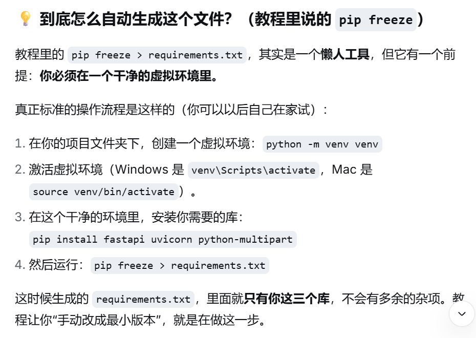

1. 判断音频时长
————subprocess的run方法，这个方法接受指令，会抛出错误，把指令输出作为文本格式输出，返回一个对象。封装了一个终端命令执行函数专门处理指令执行和异常统一。

2. 保存上传的文件
————文件传输是流式传输，一个很大的文件是一点点传的，而不是等用户传完（可能要等十几秒，延迟，并且一口气读完内存万一超限制了又要删掉这个文件，白读了）然后一口气读完，所以传一点就读一点，读到超出限制，就把本来存的这个文件的临时文件删掉，避免占内存。
：在浏览器发请求时请求头会有一个字段（Content-Length），这个字段可以标注内容长度，但是这个数据可以被伪造，同理上传文件有size属性，也是自己可以定义声明的，不可信。所以不能根据这个判断数据大小
3. 
————部署项目到平台上需要requirements这个文件，这个文件告诉部署平台需要准备什么py环境
4. Dockerfile 是一份“服务器环境搭建说明书”,把需要的环境还有软件一条条列出来，交给服务器自动执行。FROM 是基础环境、RUN 是执行命令、COPY 是复制文件、CMD 是启动命令。
5. 用了 Render 平台，通过 Docker 方式部署。写了一个 Dockerfile，基础镜像是 Python 3.11，在系统层面安装了 FFmpeg，然后通过 requirements.txt 安装 Python 依赖，最后用 uvicorn 启动 FastAPI 应用。代码推送到 GitHub 后，Render 自动检测更新并重新部署